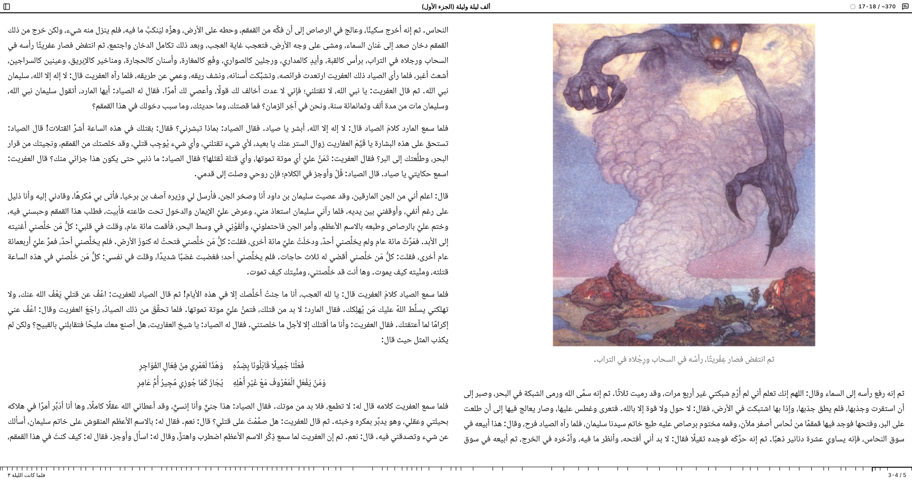

# EPUB Navigator

EPUB Navigator is the reading runtime inside [Elephant Ladder](https://github.com/redvelo/elephant-ladder).
It takes a mounted EPUB and turns it into a book you can read: frames, pages,
locations, selection, annotations, search, dictionary lookups, narration, and the
reader interface around them. It is built on [EPUB Stack](https://github.com/redvelo/epub-stack)
for everything about the publication itself.

Navigator owns what a publication sees and what the reader does. A host owns what a
browser page cannot: the origins a book runs on, the bytes it is served, storage, and
policy. Elephant Ladder is that host, on Linux and Android.

## What it does

- Opens EPUB 3 publications, reflowable and fixed layout, including spreads,
  right-to-left and vertical writing, and EPUB 3.4 roll and scrolled layouts.
- Paginates the whole book in the background so page numbers and progress are real,
  and keeps them across sessions.
- Runs a publication's own scripts without letting them near the reader: the content
  agent that lives inside a book's frame is treated as part of the book, and every
  message it sends is checked before anything acts on it.
- Gives the reader locations that survive relayout, highlights and notes that find
  their text again, footnotes in place, and search across the book.
- Plays media overlays, with the text following the narration and narration
  continuing across chapters.
- Offers dictionary lookup on a selection when the host supplies dictionaries.
- Ships a complete React reader with an interaction profile for e-ink devices.

<table>
  <tr>
    <td></td>
    <td></td>
  </tr>
  <tr>
    <td colspan="2"></td>
  </tr>
</table>

## What it is not

- Not a standalone product. The browser-local reader in this repository runs trusted
  books on a shared origin; it exists to develop and test the runtime and to run the
  corpus in Chromium.

## How a host uses it

A host provides publication facts from EPUB Stack, a base URL where the book's files
are served with the content agent injected into each document, and a browser origin
for the book that is separate from the reader. It passes those to `NavigatorReader`
with the reader's saved position, preferences, and annotations, and with whichever
capabilities it can supply: search, dictionaries, a pagination cache, media overlay
timelines. Everything crosses as data; the reader asks the host to persist or act, it
never does so itself.

The typed surface is in `src/react/public-types.ts` and the generated kernel types in
`src/generated/kernel.ts`. How Elephant Ladder hosts it, and the security boundary in
plain words, are described in that project's documentation.

## Evidence

Support claims are backed by fixtures, not prose. `pnpm test:corpus` runs the EPUB 3
Samples through the real WebAssembly projection and Chromium; the W3C EPUB
reading-system test corpus runs through Elephant Ladder on packaged Linux and Android,
with the implementation reports committed there under `tests/fixtures/w3c-corpus/`.
Browser engines other than Chromium are not supported.

## Development

Node.js 22.13 or newer, pnpm 11, the Rust toolchain pinned in `rust-toolchain.toml`,
`wasm-pack`, and the `wasm32-unknown-unknown` target.

```sh
pnpm install
pnpm build        # WASM, package, and the reader application
pnpm dev          # the browser-local reader with the development server
pnpm test         # unit tests
pnpm test:rust    # the kernel
pnpm test:browser # Playwright, Chromium
pnpm test:corpus  # the EPUB 3 Samples compatibility suite
```

`pnpm typecheck`, `pnpm lint`, and `pnpm check:rust` are the remaining checks; CI runs
all of them.

## Repository

```text
crates/   the Rust kernel: sessions, generations, locators, and the WASM bindings
src/      the runtime, the content agent, the React reader, and the browser-local host
reader/   the browser-local reader application
tests/    unit, browser, corpus, and fixture tests, with the sample publications
```

## License

Apache-2.0 or MIT, at your option. The sample publications under `tests/fixtures`
carry their own licenses, recorded beside them.
